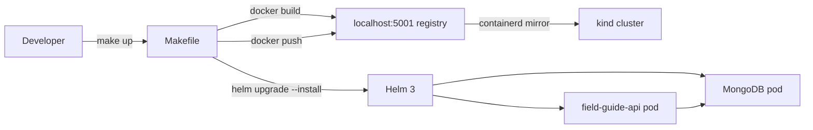

# Phase 4: Makefile + Documentation - Pattern Map

**Mapped:** 2026-07-07
**Files analyzed:** 5 (1 modified, 1 rewritten, 3 new)
**Analogs found:** 4 / 5

## File Classification

| New/Modified File | Role | Data Flow | Closest Analog | Match Quality |
|-------------------|------|-----------|----------------|---------------|
| `Makefile` (extend) | config / build orchestrator | batch (sequential shell) | `Makefile` (self) | exact |
| `README.md` (rewrite) | documentation | N/A | `charts/field-guide-api/templates/NOTES.txt` + `03-VERIFICATION.md` | role-match (demo commands) |
| `docs/troubleshooting.md` (new) | documentation | N/A | `scripts/cluster-setup.sh` (error handling prose) | partial |
| `docs/windows-setup.md` (new) | documentation | N/A | `scripts/cluster-setup.sh` (MSYS_NO_PATHCONV guard) | partial |
| `docs/known-limitations.md` (new) | documentation | N/A | none | no analog |

---

## Pattern Assignments

### `Makefile` (config / build orchestrator, batch)

**Analog:** `Makefile` (the existing file itself — extend in place, do not rewrite)

**Header pattern** (lines 1-13 — MUST be preserved verbatim):
```makefile
SHELL := /bin/bash
export MSYS_NO_PATHCONV=1

# Interpreter used to CREATE the project venv — override per host:
#   make test PYTHON="py -3.12"    (Windows Git Bash)
#   make test PYTHON=python3.11    (WSL2 / native Linux)
PYTHON ?= python3

# Image coordinates — override with: make build TAG=v1.0
IMAGE   ?= localhost:5001/field-guide-api
TAG     ?= dev
RELEASE ?= field-guide-api
CHART   ?= charts/field-guide-api
```

**Phase comment + .PHONY pattern** (line 15-17 — update the phase comment, extend .PHONY):
```makefile
# ─── Targets ──────────────────────────────────────────────────────────────────
# Phase 1: test only | Phase 2: cluster-up, cluster-down | Phase 3: build, load, deploy, undeploy
.PHONY: test cluster-up cluster-down build load deploy undeploy
```
For Phase 4, update the comment line to add the new targets and extend `.PHONY` to include:
`help up check-tools port-forward smoke clean clean-venv reset-local`

**Doc-comment target pattern** (lines 19-25, 27-29, 36-37 — every target MUST have `## name: description`):
```makefile
## test: create local venv (idempotent), install dev-deps, run pytest with coverage
test:
	cd apps/field-guide-api && \
	{ [ -d .venv ] || $(PYTHON) -m venv .venv; } && \
	VENV_PY=$$([ -x .venv/bin/python ] && echo .venv/bin/python || echo .venv/Scripts/python) && \
	"$$VENV_PY" -m pip install -q -r requirements-dev.txt && \
	"$$VENV_PY" -m pytest

## cluster-up: create kind cluster + local registry (idempotent)
cluster-up:
	bash scripts/cluster-setup.sh

## build: build the field-guide-api Docker image and tag it for the local registry
build:
	docker build -t $(IMAGE):$(TAG) apps/field-guide-api
```
Rules:
- Every target gets exactly one `## name: description` line immediately above it.
- Single-command recipes: no `$$` needed; no trailing `\`.
- Multi-command recipes: chain with `&& \`; any shell variable inside a recipe uses `$$VAR`.
- No hardcoded credentials — dev password lives only in values.yaml.

**`help` target — awk auto-generated from `## name: description` comments** (D-05):
```makefile
## help: print this help message (default goal)
.DEFAULT_GOAL := help
help:
	@awk 'BEGIN {FS = ":.*##"; printf "Usage:\n  make \033[36m<target>\033[0m\n\nTargets:\n"} \
	  /^[a-zA-Z_-]+:.*?##/ { printf "  \033[36m%-18s\033[0m %s\n", $$1, $$2 }' $(MAKEFILE_LIST)
```
The `awk` one-liner parses `## name: description` (double `##` is the convention already in the file for all existing targets — confirmed lines 19, 27, 31, 35, 39, 43, 51). The `%%` escaping for `$1`/`$2` inside a Makefile recipe becomes `$$1`/`$$2`.

**`make up` aggregate target** (D-06):
```makefile
## up: full local bring-up: cluster-up → build → load → deploy
up: cluster-up build load deploy
```
Pure prerequisite chaining — no recipe body needed. Prerequisites run in order.

**`port-forward` target** (D-07 — foreground, Ctrl-C to stop):
```makefile
## port-forward: forward svc/field-guide-api to localhost:8080 (Ctrl-C to stop)
port-forward:
	kubectl port-forward svc/$(RELEASE) 8080:80
```
This mirrors the exact command from `charts/field-guide-api/templates/NOTES.txt` line 11:
`kubectl port-forward svc/{{ include "field-guide-api.fullname" . }} 8080:{{ .Values.service.port }}`

**`smoke` target** (D-07 — background port-forward + curl PASS/FAIL):
```makefile
## smoke: background port-forward, curl /health + /entries, PASS/FAIL, cleanup
smoke:
	@echo "==> Starting smoke test..."; \
	kubectl port-forward svc/$(RELEASE) 8080:80 &>/dev/null & \
	PF_PID=$$!; \
	trap "kill $$PF_PID 2>/dev/null || true" EXIT; \
	sleep 2; \
	STATUS=0; \
	for endpoint in health entries metrics; do \
	  CODE=$$(curl -s -o /dev/null -w '%{http_code}' http://localhost:8080/$$endpoint); \
	  if [ "$$CODE" = "200" ]; then \
	    echo "  PASS  /$$endpoint → $$CODE"; \
	  else \
	    echo "  FAIL  /$$endpoint → $$CODE"; \
	    STATUS=1; \
	  fi; \
	done; \
	if [ $$STATUS -eq 0 ]; then echo "==> smoke PASSED"; else echo "==> smoke FAILED"; exit 1; fi
```
Pattern sources: `scripts/cluster-setup.sh` lines 107-131 (verification + failure exit with message). The `trap EXIT` ensures the background port-forward is killed even on failure. All shell variables use `$$`. Endpoints match NOTES.txt lines 13-15 verbatim.

**`check-tools` target** (D-08 — prerequisite doctor):
```makefile
## check-tools: verify required tools are on PATH and print versions
check-tools:
	@echo "==> Checking required tools..."; \
	PASS=1; \
	for tool in docker kind helm kubectl bash; do \
	  if command -v $$tool >/dev/null 2>&1; then \
	    echo "  ok  $$tool  ($$($$tool --version 2>&1 | head -1))"; \
	  else \
	    echo "  MISSING  $$tool"; \
	    PASS=0; \
	  fi; \
	done; \
	if [ $$PASS -eq 0 ]; then echo "==> check-tools FAILED — install missing tools"; exit 1; fi; \
	echo "==> check-tools PASSED"
```
Pattern source: `scripts/cluster-setup.sh` lines 23-36 (prerequisite gate loop `for tool in docker kubectl`). Adapted as a Makefile recipe with `$$` escaping.

**`clean` target** (D-01/02/03 — safe, non-destructive only):
```makefile
## clean: remove local caches, coverage, and temp artifacts (SAFE — no cluster/image/venv changes)
clean:
	find . -type d -name __pycache__ -exec rm -rf {} + 2>/dev/null || true
	find . -type f -name '*.pyc' -delete 2>/dev/null || true
	find . -type d -name .pytest_cache -exec rm -rf {} + 2>/dev/null || true
	find . -name .coverage -delete 2>/dev/null || true
	find . -type d -name '*.egg-info' -exec rm -rf {} + 2>/dev/null || true
```
MUST NOT: touch Docker images, volumes, kind cluster, registry, Helm releases, MongoDB PVCs, or `.venv/`. Each find command uses `|| true` to stay idempotent (matches the `|| true` idiom throughout `scripts/cluster-setup.sh`).

**`clean-venv` and `reset-local` targets** (D-03/04 — explicit destruction, separately named):
```makefile
## clean-venv: remove the app virtualenv (re-run 'make test' to recreate)
clean-venv:
	rm -rf apps/field-guide-api/.venv

## reset-local: DESTRUCTIVE — undeploy + destroy cluster + registry (loses all data)
reset-local:
	@echo "!! WARNING: This removes the Helm release, kind cluster, and local registry."
	@echo "!! All in-cluster data (MongoDB PVC contents) will be lost."
	@read -p "!! Type YES to continue: " confirm && [ "$$confirm" = "YES" ]
	$(MAKE) undeploy || true
	$(MAKE) cluster-down
```
The `read -p` confirmation guard follows the "loud echo warning" requirement (D-04). `$(MAKE)` is used to re-invoke make recursively, matching standard Makefile conventions.

---

### `README.md` (documentation, rewrite)

**Analog 1:** Current `README.md` (lines 1-16 — layout table MUST be preserved/absorbed)
```markdown
## Repository Layout

| Directory | Purpose |
|-----------|---------|
| `apps/` | Application source code (e.g. `apps/field-guide-api/`) |
| `charts/` | Helm charts for each application (e.g. `charts/field-guide-api/`) |
| `infra/kind/` | kind cluster configuration and local registry setup |
| `infra/argocd/` | PRD-2 GitOps seam — ArgoCD manifests (empty this milestone) |
| `infra/observability/` | PRD-4 observability seam — Prometheus/Grafana/Loki (empty this milestone) |
| `scripts/` | Automation scripts (cluster bootstrap, image loading, etc.) |
| `docs/` | Project documentation |
```

**Analog 2:** `charts/field-guide-api/templates/NOTES.txt` lines 9-18 — exact working demo commands (reuse verbatim for the demo flow section):
```
kubectl port-forward svc/field-guide-api 8080:80

curl http://localhost:8080/health        # expect {"status":"ok","mongo":"up"}
curl http://localhost:8080/entries       # expect [] or a list of knowledge entries
curl http://localhost:8080/metrics       # expect Prometheus-format metrics
```

**Analog 3:** `03-VERIFICATION.md` Behavioral Spot-Checks table — source of real terminal output snippets to embed as fenced code blocks (D-12). Key captures:
- `make up` / cluster-up / build / load / deploy sequence output
- `curl localhost:8080/health` → `{"status":"ok","mongo":"up"}`
- `curl localhost:8080/entries` → `[]`
- `make smoke` → `==> smoke PASSED`

**README structure** (D-09/10/11/12):
```markdown
# k8s-launchpad

[one-paragraph hook — what-this-is, portfolio framing]

## Architecture
[Mermaid diagram: developer → make → local registry → kind → Helm → app/MongoDB]

## What This Proves
[bullet list for portfolio: platform-engineering thinking items]

## Prerequisites
[table: tool, minimum version, install link]
[point to `make check-tools` as verification step — D-13/14]

## Quickstart
[clone → make check-tools → make up → make smoke]
[fenced code blocks with real terminal output — D-12]

## Developer Loop
[make build/load/deploy; make test; reference to make help]

## Demo Flow
[copy-paste session: port-forward + curl commands from NOTES.txt — D-12]

## Repository Layout
[absorbed from current README lines 5-16 — D-09]

## Security Note
[WR-07 dev password guard — reference NOTES.txt warning, deferred escalation — D-15]

## Known Limitations & Roadmap
[brief — deep content in docs/known-limitations.md]

## Troubleshooting
[brief — deep content in docs/troubleshooting.md]
```

**Mermaid diagram pattern** (D-11 — text-editable, GitHub-native rendering):
```markdown

```

---

### `docs/troubleshooting.md` (new documentation)

**Analog:** `scripts/cluster-setup.sh` error handling and exit paths (lines 23-40, 107-131) — these are the runtime failure modes a developer would encounter.

**Pattern to follow — structured symptom → cause → fix table:**
```markdown
## Troubleshooting

| Symptom | Likely Cause | Fix |
|---------|-------------|-----|
| `ERROR: kind is not installed` | kind not on PATH | Install with `winget install Kubernetes.kind` or download from https://kind.sigs.k8s.io/dl/v0.32.0/kind-windows-amd64.exe |
| `ERROR: Docker daemon is not running` | Docker Desktop not started | Start Docker Desktop; wait for whale icon in taskbar |
| `ImagePullBackOff` on registry-verify pod | containerd mirror not patched | Re-run `make cluster-up` (idempotent); check node hosts.toml |
| `bad interpreter: No such file or directory` | CRLF in shell scripts | `git config core.autocrlf false` + re-checkout; `.gitattributes` enforces LF |
| `/health` returns 503 | MongoDB pod not Ready yet | Wait ~30s; `kubectl get pods`; check `kubectl logs -l app.kubernetes.io/name=field-guide-api-mongodb` |
| port-forward dies silently | Previous `kubectl port-forward` still running | `pkill -f "kubectl port-forward"` then retry |
```

Source for error messages: `cluster-setup.sh` lines 24-26, 38-40; `03-VERIFICATION.md` behavioral evidence.

---

### `docs/windows-setup.md` (new documentation)

**Analog:** `scripts/cluster-setup.sh` line 13 (`export MSYS_NO_PATHCONV=1`) and `Makefile` line 2 — the Windows-specific guards already in the codebase.

**Content to cover:**
- Git Bash as the primary documented path (D-13)
- `winget install` commands for Docker, kind, Helm, kubectl
- WSL2 as optional/secondary path
- Why `MSYS_NO_PATHCONV=1` matters (Git Bash path-conversion bug with `//` paths)
- `.gitattributes` LF enforcement — why CRLF breaks shell scripts on WSL2/Git Bash

---

### `docs/known-limitations.md` (new — no analog)

**No analog exists in the codebase.** The planner should reference `REQUIREMENTS.md` Out-of-Scope table (lines 82-90) and the deferred PRD list for content:

Content to derive from `REQUIREMENTS.md` Out-of-Scope table:
- No ArgoCD/GitOps yet (PRD-2 seam only)
- No platform dashboard/UI yet (PRD-3 seam only)  
- No Prometheus/Grafana/Loki/Trivy yet (PRD-4 seam only)
- Port-forward only — no Ingress/TLS
- kind cluster is ephemeral — MongoDB PVC data lost on `make cluster-down`
- WR-07: committed dev password (`fieldguide-dev-password`) — local kind only, `values.yaml` line 53
- gunicorn `/home/app` permission warning in startup logs (harmless — from `03-VERIFICATION.md` human verification note)

---

## Shared Patterns

### Idempotency Guard (`|| true`)
**Source:** `scripts/cluster-setup.sh` lines 44, 85, 90, 128-129
**Apply to:** `clean` target (every `find` command), `reset-local` `undeploy` call
```bash
docker inspect "${reg_name}" >/dev/null 2>&1 || true
kubectl delete pod registry-verify --ignore-not-found
```
All cleanup steps use `|| true` or `--ignore-not-found` so re-runs never error on "already gone".

### `$$` Shell Variable Escaping in Makefile Recipes
**Source:** `Makefile` lines 23-25 (test target)
```makefile
VENV_PY=$$([ -x .venv/bin/python ] && echo .venv/bin/python || echo .venv/Scripts/python) && \
"$$VENV_PY" -m pip install -q -r requirements-dev.txt && \
"$$VENV_PY" -m pytest
```
**Apply to:** Every multi-line recipe in new targets (`smoke`, `check-tools`, `reset-local`) that uses shell variables. Single `$` → Makefile variable expansion. `$$` → shell variable at recipe runtime.

### Prerequisite Gate Pattern
**Source:** `scripts/cluster-setup.sh` lines 23-36
```bash
command -v kind >/dev/null 2>&1 || {
  echo "ERROR: kind is not installed or not on PATH."
  exit 1
}
for tool in docker kubectl; do
  command -v "$tool" >/dev/null 2>&1 || {
    echo "ERROR: $tool is not installed or not on PATH."
    exit 1
  }
done
```
**Apply to:** `check-tools` target (adapted as Makefile recipe with `$$` variables and `command -v $$tool`).

### Echo Banner Pattern
**Source:** `scripts/cluster-setup.sh` lines 43, 63, 72, 83, 92, 106
```bash
echo "==> Step N: ..."
echo "    Detail message."
echo "==> Section complete."
```
**Apply to:** `smoke` target echo lines, `check-tools` output lines, `reset-local` warning banner. Use `==>` prefix for section headers, 4-space indent for details. Matches existing script style exactly.

### WR-07 Dev Password Warning
**Source:** `charts/field-guide-api/templates/NOTES.txt` lines 2-7
```
{{- if and .Values.mongodb.enabled (eq .Values.mongodb.auth.password "fieldguide-dev-password") }}

  !! WARNING: MongoDB is running with the COMMITTED local-dev password.
  !! This is acceptable ONLY on a local kind cluster.
{{- end }}
```
**Apply to:** README.md security note section and `docs/known-limitations.md`. Wording must stay consistent with this NOTES.txt text to avoid conflicting messages.

---

## No Analog Found

| File | Role | Data Flow | Reason |
|------|------|-----------|--------|
| `docs/known-limitations.md` | documentation | N/A | No existing docs/ content in codebase; derive content from `REQUIREMENTS.md` Out-of-Scope table and `03-VERIFICATION.md` human verification note |

---

## Metadata

**Analog search scope:** `Makefile`, `scripts/`, `charts/field-guide-api/templates/`, `README.md`, `.planning/phases/03-*`
**Files scanned:** 8 source files read in full
**Pattern extraction date:** 2026-07-07
