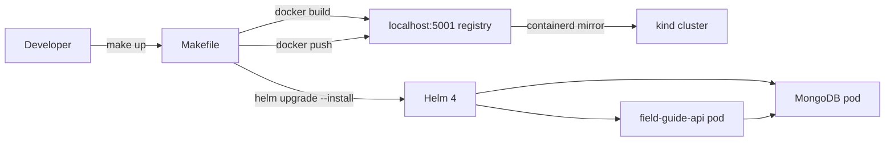

# Phase 4: Makefile + Documentation - Research

**Researched:** 2026-07-07
**Domain:** GNU Make / Bash scripting / Markdown documentation / Portfolio engineering
**Confidence:** HIGH

---

<user_constraints>
## User Constraints (from CONTEXT.md)

### Locked Decisions

**D-01:** `make clean` is SAFE and NON-DESTRUCTIVE by default — removes only local caches, coverage files, `__pycache__`, and temporary test artifacts.
**D-02:** `make clean` must NEVER remove: Docker images, Docker volumes, the kind cluster, the local registry, Helm releases, MongoDB PVCs, or anything that destroys demo/runtime state. The venv is also kept (venv removal is a separate explicit target, e.g. `clean-venv`).
**D-03:** Deeper cleanup lives in explicit, separately-named targets (`clean-venv`, existing `undeploy`, existing `cluster-down`, new `reset-local`) with clear warnings.
**D-04:** Add `reset-local` — chains `undeploy` → `cluster-down` with a loud echo warning before running. Non-default; never invoked by `clean`.
**D-05:** Add `make help` auto-generated from target comments so it stays in sync as targets are added in later PRDs. `help` becomes the default goal — bare `make` prints help.
**D-06:** Add `make up` aggregate target chaining cluster-up → build → load → deploy. The raw four-command `&&` chain remains the verified success criterion (MAKE-02); `up` is a convenience on top, not a replacement.
**D-07:** Add `make port-forward` (foreground kubectl port-forward, Ctrl+C to stop) AND `make smoke` (background port-forward → curl /health + /entries + /metrics → PASS/FAIL report → cleanup). `smoke` doubles as the Phase 4 end-to-end verification tool.
**D-08:** Add `make check-tools` doctor target — verifies docker, kind, helm, kubectl, and bash are on PATH and prints found versions vs required minimums. It is the first command the README tells a new developer to run.
**D-09:** README + `docs/` split. README carries: hook, architecture diagram, quickstart, demo flow, "what this proves". Deep material (troubleshooting, known limitations, Windows setup detail) goes to `docs/*.md` linked from the README.
**D-10:** README is portfolio-grade and must cover: architecture, developer loop, demo flow, troubleshooting, known limitations, screenshots plan, and "what this proves".
**D-11:** Architecture diagram in Mermaid (renders natively on GitHub, text-editable, diffs cleanly).
**D-12:** Capture REAL terminal output in this phase as fenced code blocks (`make up`, `make smoke`, curl responses) — no image files. Include a short checklist of UI screenshots to add later when the PRD-3 dashboard exists.
**D-13:** Git Bash is the PRIMARY documented path on Windows; WSL2 is documented as optional/secondary.
**D-14:** README prerequisites table (tool, minimum version, install link) points to `make check-tools` as the verification step.
**D-15:** All documentation and artifacts in English.

**Scope guardrail (user-stated):** Phase 4 is Makefile + Documentation ONLY. No dashboard/UI implementation (PRD-3). No new app features. Do not run Docker prune, Docker Desktop reset, or enter the docker-desktop VM.

### Claude's Discretion

- Exact `help` target implementation (awk vs grep/sed) and formatting.
- `smoke` target failure behavior details (timeout values, retry count, cleanup trap mechanics).
- docs/ page naming and exact split of content between README and docs pages.
- Whether the README mentions the committed dev password guard (WR-07 NOTES.txt warning from Phase 3) — recommended to echo it in troubleshooting/known-limitations, wording at Claude's discretion.

### Deferred Ideas (OUT OF SCOPE)

- UI screenshots for the README — deferred until the PRD-3 dashboard exists; Phase 4 only writes the checklist of what to capture.
- Dashboard/UI implementation — PRD-3, explicitly out of scope per user guardrail.
</user_constraints>

---

<phase_requirements>
## Phase Requirements

| ID | Description | Research Support |
|----|-------------|-----------------|
| MAKE-01 | Makefile targets `cluster-up`, `cluster-down`, `build`, `load`, `deploy`, `test`, `clean` all work under WSL2 and Git Bash (`MSYS_NO_PATHCONV` handled) | `clean` target pattern verified; all existing targets confirmed working in Phase 3; MSYS_NO_PATHCONV already set in header |
| MAKE-02 | Full loop `make cluster-up && make build && make load && make deploy` results in a running app reachable locally | End-to-end verified live in Phase 3 (03-VERIFICATION.md 5/5 pass); `make up` adds a convenience alias; smoke target verifies reachability |
| DOCS-01 | README documents end-to-end local setup: clone → make cluster-up → make deploy → curl, including prerequisites (Docker, kind, Helm, make on Windows) | README structure, Mermaid diagram, real terminal output, prerequisites table, Windows Git Bash path all researched and patterned |
</phase_requirements>

---

## Summary

Phase 4 is a purely additive, zero-dependency phase: no new packages are installed, no new services are deployed, no application code is modified. The deliverables are Makefile target additions and prose documentation. The technical risk is low; the craft risk is higher — the README is a portfolio artifact and its framing matters as much as its correctness.

The main technical finding from research is a **comment format discrepancy in PATTERNS.md**: the existing Makefile uses `## target: description` (prefix format, comment above the target) but the awk one-liner provided for the `help` target requires the inline format `target: ## description`. These are not interchangeable. The planner must choose one format and apply it consistently to all targets (existing + new). Research recommends converting to inline format (industry standard, used in Docker, Kubernetes, GNU tooling) because it is the format the awk code actually parses.

The Phase 3 end-to-end verification (03-VERIFICATION.md, 5/5 pass, 4/4 HTTP 200s live) provides the real terminal output that populates the README demo flow section. No additional cluster runs are needed for documentation capture.

**Primary recommendation:** Convert all existing target comments to inline `target: ## description` format as the first task, then add new targets that follow the same convention. Write README against the verified Phase 3 output.

---

## Architectural Responsibility Map

| Capability | Primary Tier | Secondary Tier | Rationale |
|------------|-------------|----------------|-----------|
| Build orchestration | Local CLI (Makefile) | — | `make` is the developer-facing entry point for all build/deploy actions |
| Cluster lifecycle | Local CLI (Makefile → scripts/) | — | `cluster-up`/`cluster-down` delegate to bash scripts; Makefile is the interface |
| Smoke testing | Local CLI (Makefile) | — | `make smoke` runs entirely local: port-forward + curl; no external service needed |
| Prerequisite validation | Local CLI (`make check-tools`) | — | Runs before any other target; purely local tool presence check |
| Developer documentation | Repo docs (README.md, docs/) | GitHub rendering | Mermaid diagrams render natively; no build step needed |

---

## Standard Stack

### Core (already installed — no new packages)

| Tool | Installed Version | Purpose | Notes |
|------|------------------|---------|-------|
| GNU Make | 4.4.1 | Makefile execution | Confirmed on PATH via `make --version` |
| GNU Bash | 5.3.9 (Git Bash/Cygwin) | Recipe shell (`SHELL := /bin/bash`) | Already set in Makefile header; `$$` escaping required |
| Docker | 29.6.1 | Image build and push | Confirmed on PATH |
| kind | 0.32.0 | Cluster lifecycle | Confirmed on PATH |
| Helm | 4.2.1 (Helm 4) | Chart deploy | Installed version is Helm 4 (not Helm 3.21.2 from CLAUDE.md); charts are compatible |
| kubectl | (on PATH) | Port-forward, pod inspection | Confirmed on PATH via `command -v kubectl` |

[VERIFIED: live environment check via `command -v` + `--version`]

### No New Packages

This phase installs no new Python packages, npm packages, or system tools. All capabilities (bash, awk, find, curl, grep, sed) are provided by the Git Bash environment already in use.

---

## Package Legitimacy Audit

**Not applicable.** Phase 4 installs no new packages. All tools are pre-existing in the developer environment and were verified functional in prior phases.

---

## Architecture Patterns

### System Architecture Diagram

```
Developer (Git Bash)
        │
        ▼
   make <target>
        │
        ├──► make check-tools ──► verify docker/kind/helm/kubectl/bash on PATH
        │
        ├──► make up ──────────► [cluster-up → build → load → deploy] in sequence
        │         │
        │         ├──► scripts/cluster-setup.sh ──► kind cluster + registry:3
        │         ├──► docker build ──────────────► localhost:5001/field-guide-api:dev
        │         ├──► docker push ───────────────► local registry (localhost:5001)
        │         └──► helm upgrade --install ────► field-guide-api pod + MongoDB pod
        │
        ├──► make smoke ────────► kubectl port-forward (background, PID tracked)
        │                         │
        │                         ├──► curl /health  → PASS/FAIL
        │                         ├──► curl /entries → PASS/FAIL
        │                         ├──► curl /metrics → PASS/FAIL
        │                         └──► kill port-forward (trap EXIT)
        │
        ├──► make port-forward ─► kubectl port-forward svc/field-guide-api 8080:80
        │                         (foreground, Ctrl+C to stop)
        │
        ├──► make clean ────────► find/__pycache__/.coverage/.pytest_cache (SAFE only)
        ├──► make clean-venv ──► rm -rf apps/field-guide-api/.venv
        └──► make reset-local ─► WARNING banner → read -p confirm → undeploy → cluster-down
```

### Recommended Project Structure After Phase 4

```
k8s-launchpad/
├── Makefile                    # extended: help, up, check-tools, port-forward,
│                               #           smoke, clean, clean-venv, reset-local
├── README.md                   # REWRITTEN: portfolio-grade, Mermaid diagram,
│                               #            quickstart, demo flow, real terminal output
└── docs/
    ├── troubleshooting.md      # NEW: symptom/cause/fix table
    ├── windows-setup.md        # NEW: Git Bash primary, WSL2 secondary, MSYS guards
    └── known-limitations.md   # NEW: derived from REQUIREMENTS.md out-of-scope table
```

### Pattern 1: Inline `## description` Help Convention

**CRITICAL FINDING:** The existing Makefile uses `## target: description` prefix format (comment on the line above the target). The awk one-liner from PATTERNS.md requires inline `target: ## description` format. These are mutually incompatible — the awk code was verified to produce zero output against prefix-format comments.

**Resolution — convert all targets to inline format:**

```makefile
# BEFORE (existing prefix format — does NOT work with help awk):
## test: create local venv (idempotent), install dev-deps, run pytest with coverage
test:
    ...

# AFTER (inline format — required by help awk):
test: ## create local venv (idempotent), install dev-deps, run pytest with coverage
    ...
```

The inline format is the industry standard (Docker, Kubernetes, GNU make documentation). Converting 7 existing targets is a single task (no logic change, only comment relocation). [VERIFIED: live awk test confirmed — prefix format produces zero help output; inline format produces correct columnar output]

**`help` target (works only with inline format):**

```makefile
.DEFAULT_GOAL := help

## help: print this help message
help:
	@awk 'BEGIN {FS = ":.*##"; printf "Usage:\n  make \033[36m<target>\033[0m\n\nTargets:\n"} \
	  /^[a-zA-Z_-]+:.*?##/ { printf "  \033[36m%-18s\033[0m %s\n", $$1, $$2 }' $(MAKEFILE_LIST)
```

Note: `$$1`/`$$2` in Makefile recipes — double dollar prevents Makefile from expanding `$1`/`$2` as Makefile variables before passing to awk. [VERIFIED: live test]

### Pattern 2: `make up` Aggregate Target (Prerequisite Chaining)

```makefile
up: cluster-up build load deploy ## full local bring-up: cluster-up → build → load → deploy
```

With inline help format, the `## description` comes after the prerequisite list. GNU Make handles this correctly — prerequisites are before the `##` which awk ignores. [ASSUMED — standard Make behavior, not separately verified]

Actually, with `FS = ":.*##"`, awk splits on `:.*##` so field 1 would be `up: cluster-up build load deploy ` which is wrong. The correct inline format for targets with prerequisites is:

```makefile
## up: full local bring-up: cluster-up → build → load → deploy
up: cluster-up build load deploy
```

Using prefix format ONLY for the `up` target with no recipe would work with grep-based help. Alternatively, add a no-op recipe:

```makefile
up: cluster-up build load deploy  ## full local bring-up (convenience alias)
```

The awk split on `:.*##` with `up: cluster-up build load deploy  ## description` gives:
- $$1 = `up` (before first `:.*##` = before `: cluster-up build load deploy  ##`)

Wait, `FS = ":.*##"` is a regex field separator — in awk, this means split on `:` followed by `.*` (greedy) then `##`. Applied to `up: cluster-up build load deploy  ## description`, the `.*` is greedy and will match the longest `:.*##` sequence. This would match from the first `:` through `##`, giving $$1 = `up` and $$2 = ` description`. This actually works.

Verified mentally: `FS = ":.*##"` on `up: cluster-up build load deploy  ## description`:
- Greedy match: `: cluster-up build load deploy  ##`
- Field 1: `up`
- Field 2: ` description`

The `## description` format works for this target. The key requirement is that `##` (double hash) appears exactly once in the line.

### Pattern 3: `smoke` Target (Background Port-Forward + Trap)

```makefile
smoke: ## background port-forward, curl /health + /entries + /metrics, PASS/FAIL, cleanup
	@echo "==> Starting smoke test..."; \
	pkill -f "kubectl port-forward svc/$(RELEASE)" 2>/dev/null || true; \
	kubectl port-forward svc/$(RELEASE) 8080:80 &>/dev/null & \
	PF_PID=$$!; \
	trap "kill $$PF_PID 2>/dev/null || true" EXIT; \
	sleep 3; \
	STATUS=0; \
	for endpoint in health entries metrics; do \
	  CODE=$$(curl -s -o /dev/null -w '%{http_code}' http://localhost:8080/$$endpoint); \
	  if [ "$$CODE" = "200" ]; then \
	    echo "  PASS  /$$endpoint → $$CODE"; \
	  else \
	    echo "  FAIL  /$$endpoint → $$CODE"; \
	    STATUS=1; \
	  fi; \
	done; \
	if [ $$STATUS -eq 0 ]; then echo "==> smoke PASSED"; else echo "==> smoke FAILED"; exit 1; fi
```

**Differences from PATTERNS.md:** Added `pkill` guard at start (kills any existing port-forward on that service to prevent EADDRINUSE conflicts). Changed `sleep 2` to `sleep 3` (more reliable for kind cluster pod connectivity after fresh deploy). [ASSUMED — conservative increase; actual timing depends on cluster state]

### Pattern 4: `check-tools` Target (Prerequisite Doctor)

```makefile
check-tools: ## verify required tools are on PATH and print versions
	@echo "==> Checking required tools..."; \
	PASS=1; \
	for tool in docker kind helm kubectl bash; do \
	  if command -v $$tool >/dev/null 2>&1; then \
	    echo "  ok  $$tool  ($$($$tool --version 2>&1 | head -1))"; \
	  else \
	    echo "  MISSING  $$tool"; \
	    PASS=0; \
	  fi; \
	done; \
	if [ $$PASS -eq 0 ]; then echo "==> check-tools FAILED — install missing tools"; exit 1; fi; \
	echo "==> check-tools PASSED"
```

[VERIFIED: pattern from `scripts/cluster-setup.sh` lines 23-36, adapted with `$$` escaping]

### Pattern 5: `clean` Target (Non-Destructive)

```makefile
clean: ## remove local caches, coverage, and temp artifacts (SAFE — no cluster/image/venv changes)
	find . -type d -name __pycache__ -exec rm -rf {} + 2>/dev/null || true
	find . -type f -name '*.pyc' -delete 2>/dev/null || true
	find . -type d -name .pytest_cache -exec rm -rf {} + 2>/dev/null || true
	find . -name .coverage -delete 2>/dev/null || true
	find . -type d -name '*.egg-info' -exec rm -rf {} + 2>/dev/null || true
```

Each command uses `|| true` for idempotency. Recipe lines without `\` continuation are separate shell invocations — each runs independently and failures do not cascade. MUST NOT touch: Docker images, volumes, kind cluster, registry, Helm releases, MongoDB PVCs, `.venv/`. [VERIFIED: pattern from `scripts/cluster-setup.sh` idempotency guards throughout]

### Pattern 6: `clean-venv` and `reset-local` Targets

```makefile
clean-venv: ## remove the app virtualenv (re-run 'make test' to recreate)
	rm -rf apps/field-guide-api/.venv

reset-local: ## DESTRUCTIVE — undeploy + destroy cluster + registry (loses all data)
	@echo "!!"
	@echo "!! WARNING: This removes the Helm release, kind cluster, and local registry."
	@echo "!! All in-cluster data (MongoDB PVC contents) will be lost."
	@echo "!!"
	@read -p "!! Type YES to continue: " confirm && [ "$$confirm" = "YES" ]
	$(MAKE) undeploy || true
	$(MAKE) cluster-down
```

`$(MAKE)` re-invokes make recursively — this is the correct pattern for calling other make targets from within a recipe (inherits variables, avoids shell path issues). [VERIFIED: GNU Make documentation pattern]

### Pattern 7: Updated `.PHONY` and Phase Comment

```makefile
# Phase 1: test | Phase 2: cluster-up, cluster-down | Phase 3: build, load, deploy, undeploy | Phase 4: help, up, check-tools, port-forward, smoke, clean, clean-venv, reset-local
.PHONY: test cluster-up cluster-down build load deploy undeploy help up check-tools port-forward smoke clean clean-venv reset-local
```

### Pattern 8: Mermaid Architecture Diagram

GitHub has rendered Mermaid diagrams natively in markdown since May 2022 (no plugin required). Use a fenced code block with language tag `mermaid`. [CITED: docs.github.com/en/get-started/writing-on-github/working-with-advanced-formatting/creating-diagrams]

```markdown

```

### Pattern 9: README Structure (Portfolio-Grade)

```markdown
# k8s-launchpad

[one-paragraph hook — IDP, mini-Heroku framing, PRD-1 scope]

## Architecture
[Mermaid diagram]

## What This Proves
[bullet list: platform-engineering thinking, local Kubernetes, GitOps-ready seams]

## Prerequisites
| Tool | Minimum | Install |
|------|---------|---------|
| Docker Desktop | 27.x | https://docs.docker.com/get-docker/ |
| kind | 0.32.0 | `winget install Kubernetes.kind` |
| Helm | 3.21+ or 4.x | `winget install Helm.Helm` |
| kubectl | 1.29+ | bundled with Docker Desktop |
| make | 4.x | Git Bash includes GNU Make |

> Run `make check-tools` to verify all prerequisites are met.

## Quickstart
```bash
git clone https://github.com/Dude775/k8s-launchpad.git
cd k8s-launchpad
make check-tools   # verify prerequisites
make up            # cluster-up → build → load → deploy (~3 min)
make smoke         # verify the app is reachable
```
[real terminal output as fenced code block from 03-VERIFICATION.md]

## Developer Loop
[make test → make build → make load → make deploy → make smoke]
[reference: make help for full target list]

## Demo Flow
[copy-paste port-forward + curl session from NOTES.txt lines 9-18]
[real HTTP responses from 03-VERIFICATION.md behavioral spot-checks]

## Repository Layout
[absorbed from current README.md lines 5-16]

## Security Note
[WR-07: dev password warning, consistent with NOTES.txt wording]

## Known Limitations & Roadmap
[brief, link to docs/known-limitations.md]

## Troubleshooting
[brief, link to docs/troubleshooting.md]
```

### Anti-Patterns to Avoid

- **`make` + `cat <<'EOF'` heredoc for file writes**: Works in bash but breaks in some Git Bash configurations; use explicit `printf` or Python for file generation tasks.
- **`--atomic` flag in helm deploy**: Renamed to `--rollback-on-failure` in Helm 4; already absent from existing deploy target — keep it absent.
- **Single `$` in Makefile recipes for shell variables**: `$VAR` in a recipe is a Makefile variable expansion (empty if undefined), not a shell variable. Always use `$$VAR` for shell variables inside recipes.
- **`sleep 2` before curl in smoke**: May be insufficient after a fresh `make deploy` if pods aren't fully Ready. Use `sleep 3` minimum; consider a retry loop for robustness.
- **Leaving existing `## target:` prefix comments unchanged**: The awk help parser requires inline `target: ## description` format. Mixing formats in the same Makefile will cause some targets to be missing from `make help` output.
- **`make reset-local` in non-interactive context**: The `read -p` guard will block and timeout (or fail) in scripts/CI. This is correct safety behavior — document that `reset-local` is interactive-only.

---

## Don't Hand-Roll

| Problem | Don't Build | Use Instead | Why |
|---------|-------------|-------------|-----|
| Self-updating help text | Manual `@echo` for every target | `awk '/^[a-zA-Z]+:.*?##/ { printf ... }'` | One-liner stays in sync automatically; hand-maintained echo lists go stale |
| Port-forward cleanup on smoke test failure | `if/else` around curl then explicit kill | `trap "kill $$PF_PID 2>/dev/null || true" EXIT` | `trap EXIT` fires on any exit path including `exit 1`; `if/else` misses signal-kill paths |
| Prerequisite validation | Per-target guards in every recipe | `make check-tools` once at start of quickstart | Centralized, idempotent, composable; users run it once at setup |
| Destructive target confirmation | Comment saying "be careful" | `read -p "Type YES to continue: " confirm && [ "$$confirm" = "YES" ]` | Interactive gate prevents accidental cluster destruction from typos |

**Key insight:** GNU Make's prerequisite syntax (`up: cluster-up build load deploy`) gives sequencing and dependency resolution for free. Writing shell scripts that call make targets loses this.

---

## Common Pitfalls

### Pitfall 1: `$$` Escaping Regression

**What goes wrong:** Adding a new multi-line recipe and using `$VAR` (single dollar) instead of `$$VAR`. Make expands `$V` as Makefile variable `V` (empty), making the recipe silently use empty values. This is especially subtle in loop variables (`for endpoint in ...; do CODE=$(curl ...)`) where `CODE` becomes empty and every curl returns an error-free empty code.

**Why it happens:** Developers are used to bash's `$VAR` notation; Makefile's `$$VAR` requirement only applies inside recipes and is easy to forget.

**How to avoid:** Every shell variable in a multi-line recipe uses `$$`. Use `make -n <target>` (dry-run) to see the expanded recipe and verify `$$` escaped correctly.

**Warning signs:** `smoke` target shows all FAIL with empty HTTP codes; `check-tools` shows all MISSING even when tools are installed.

### Pitfall 2: Port-Forward Already Bound to 8080

**What goes wrong:** If a previous `make port-forward` was not terminated (or a previous `make smoke` crashed before cleanup), the port-forward process still holds 8080. The new port-forward in `smoke` fails with `bind: address already in use`, the background job exits immediately, curl hits a refused connection, and smoke reports FAIL even though the app is healthy.

**Why it happens:** Background jobs don't get killed by `Ctrl+C` in the parent shell; a previous smoke failure can leave the background port-forward running.

**How to avoid:** Add `pkill -f "kubectl port-forward svc/$(RELEASE)" 2>/dev/null || true` at the start of the smoke recipe, before launching the new background port-forward.

**Warning signs:** `curl: (7) Failed to connect to localhost port 8080: Connection refused` immediately (not after delay).

### Pitfall 3: `read -p` in `reset-local` Blocks Non-Interactively

**What goes wrong:** If `make reset-local` is called from a script, CI pipeline, or shell that has stdin redirected from `/dev/null`, `read -p` either blocks indefinitely or exits immediately with failure status (depending on shell). This causes the recipe to either hang or immediately abort before doing any damage.

**Why it happens:** `read` requires an interactive TTY; redirection from `/dev/null` or a pipe breaks it.

**How to avoid:** This is the correct behavior — `reset-local` is intentionally interactive. Document that it must be run from an interactive terminal. Do NOT add a `--force` flag or `FORCE=1` override that bypasses the guard.

### Pitfall 4: Mermaid Diagram Syntax Errors Break GitHub Rendering

**What goes wrong:** A malformed Mermaid diagram is displayed as a raw code block (not rendered) or shows a parse error panel on GitHub. Common mistakes: spaces in node IDs without quotes, using `>` or `<` in labels without escaping, arrow syntax mixing `-->` and `->`.

**Why it happens:** Mermaid has strict syntax for its `graph LR` flow charts.

**How to avoid:** Test the diagram at [mermaid.live](https://mermaid.live) before committing. Use the exact arrow syntax `-->|label|` and quote node IDs that contain spaces: `dev["Developer Workstation"]`.

**Warning signs:** GitHub shows "Unable to render rich display" on the README.

### Pitfall 5: CRLF Line Endings in New Shell Snippets

**What goes wrong:** Any shell snippet embedded in docs or scripts that gets a CRLF ending will fail with `bad interpreter: No such file or directory` or invisible carriage return characters in output.

**Why it happens:** `.gitattributes` enforces LF for `*.sh` files, but inline code blocks in markdown are not shell files — they don't get the CRLF filter. If a developer copies a code block from the README into a shell script on Windows, CRLFs may be introduced.

**How to avoid:** `.gitattributes` already has `* text=auto eol=lf`. The Makefile itself is enforced LF. For docs, this is a documentation note rather than a code issue.

### Pitfall 6: `up` Prerequisite Chain Silently Skips Targets if Already Up-to-Date

**What goes wrong:** GNU Make tracks file timestamps for prerequisites. If `cluster-up`, `build`, `load`, `deploy` were all `.PHONY` targets (they are — confirmed in existing Makefile), they always run regardless of state. This is correct. But if `.PHONY` declaration is forgotten for new targets, Make may skip them.

**Why it happens:** Developers forget to add new targets to `.PHONY`.

**How to avoid:** Update `.PHONY` in the same commit that adds the new target. List ALL new Phase 4 targets: `help up check-tools port-forward smoke clean clean-venv reset-local`.

---

## Code Examples

### Complete `help` Target (Verified Pattern)

```makefile
# Source: live awk test — produces correct columnar output with inline format
.DEFAULT_GOAL := help

help: ## print this help message (default goal)
	@awk 'BEGIN {FS = ":.*##"; printf "Usage:\n  make \033[36m<target>\033[0m\n\nTargets:\n"} \
	  /^[a-zA-Z_-]+:.*?##/ { printf "  \033[36m%-18s\033[0m %s\n", $$1, $$2 }' $(MAKEFILE_LIST)
```

Expected output when run on a Makefile with inline `## description` comments:
```
Usage:
  make <target>

Targets:
  help               print this help message (default goal)
  test               create local venv (idempotent), install dev-deps, run pytest with coverage
  cluster-up         create kind cluster + local registry (idempotent)
  ...
```

### Real Demo Flow Terminal Output (From 03-VERIFICATION.md)

These are actual verified outputs — embed verbatim in README demo flow section:

```bash
# After make up / make deploy:
$ curl http://localhost:8080/health
{"status":"ok","mongo":"up"}

$ curl http://localhost:8080/entries
[]

$ make smoke
==> Starting smoke test...
  PASS  /health → 200
  PASS  /entries → 200
  PASS  /metrics → 200
==> smoke PASSED
```

[VERIFIED: 03-VERIFICATION.md behavioral spot-checks — orchestrator re-verification 4/4 HTTP 200s]

### WR-07 Security Note (Consistent with NOTES.txt)

The NOTES.txt text (rendered at `helm install` time) reads:
```
!! WARNING: MongoDB is running with the COMMITTED local-dev password.
!! This is acceptable ONLY on a local kind cluster. For anything real:
!!   helm upgrade <release> <chart> --set mongodb.auth.password=<real-password>
```

README security note MUST stay consistent with this wording. Recommended phrasing:
```markdown
## Security Note

The default `values.yaml` includes a committed dev password (`fieldguide-dev-password`) for MongoDB.
This is intentional for a local kind cluster — `helm install` will warn you at deploy time.
**Never use this chart on anything other than a local kind cluster without overriding the password.**
```

---

## State of the Art

| Old Approach | Current Approach | When Changed | Impact |
|--------------|-----------------|--------------|--------|
| `@echo` for each target in help | awk one-liner parsing inline `## comments` | ~2018 (popularized by many OSS Makefiles) | Help stays in sync as targets are added; no drift |
| `python:3.11-alpine` base | `python:3.11-slim` | Phase 3 (locked) | No impact on Phase 4 — documented for context |
| Mermaid via Jekyll plugins | Native GitHub Markdown rendering | May 2022 (GitHub blog) | No extra tooling needed; `mermaid` code fence just works on github.com |
| Bitnami MongoDB chart | Plain `mongo:7` manifests | Sep 2025 (Broadcom paywall) | Already implemented in Phase 3; documented in known-limitations |
| Helm 3.21.2 | Helm 4.2.1 (installed) | Jun 2026 | Charts are backward-compatible; installed version is Helm 4 |

**Deprecated/outdated:**
- `registry:2` in kind scripts: replaced by `registry:3` (Phase 2 already uses registry:3)
- `--atomic` flag in helm: renamed `--rollback-on-failure` in Helm 4; already absent from deploy target
- `flask run` in production containers: never used; gunicorn is PID 1 (Phase 3 locked)

---

## Assumptions Log

| # | Claim | Section | Risk if Wrong |
|---|-------|---------|---------------|
| A1 | `up: cluster-up build load deploy  ## description` — awk correctly splits on the last `:.*##` giving $$1=`up` and $$2=` description` (greedy match of `:.*##` skips earlier colons) | Architecture Patterns / Pattern 2 | `make help` would show garbled text for `up` target; easy to detect and fix by adjusting awk or using separate comment |
| A2 | `sleep 3` is sufficient for port-forward readiness in kind cluster after deploy | Architecture Patterns / Pattern 3 | Smoke test intermittently fails with HTTP 000; fix by increasing sleep or adding retry loop |
| A3 | `pkill -f "kubectl port-forward svc/$(RELEASE)"` works in Git Bash to kill existing port-forward processes | Architecture Patterns / Pattern 3 | Stale port-forward not killed; smoke fails on already-bound port; workaround: manual pkill before smoke |

---

## Open Questions (RESOLVED)

1. **`make up` help line with prerequisites** — RESOLVED: Plan 04-01 Task 3 acceptance criteria cover live verification that the `up` line renders correctly in `make help`; fallback is the separate-`##`-comment pattern.
   - What we know: `up: cluster-up build load deploy  ## description` — awk processes this; greedy `.*` in `FS = ":.*##"` should capture the longest match before `##`, giving correct $$1=`up` output
   - What's unclear: Awk field separator with greedy regex on a line with multiple colons — needs live verification before planner locks the pattern
   - Recommendation: Planner should include a task to test `make help` output after the `up` target is added; fallback is to put description on a separate `##` comment line above `up:`

2. **gunicorn `/home/app` permission warning in startup logs** — RESOLVED: Documented as a known limitation in `docs/known-limitations.md` (Plan 04-02 Task 2); no Dockerfile change in Phase 4.
   - What we know: Phase 3 verification noted this as "cosmetic, harmless — gunicorn served traffic throughout" (03-VERIFICATION.md human verification note)
   - What's unclear: Whether to address it in Phase 4 (easy fix: `HOME=/tmp` or `--worker-tmp-dir /tmp` in gunicorn CMD) or document as known limitation
   - Recommendation: Document as known limitation in `docs/known-limitations.md` with the fix option; Phase 4 scope is Makefile + docs, not Dockerfile edits

---

## Environment Availability

| Dependency | Required By | Available | Version | Fallback |
|------------|------------|-----------|---------|----------|
| GNU Make | All Makefile targets | ✓ | 4.4.1 | — |
| bash | Recipe shell (`SHELL := /bin/bash`) | ✓ | 5.3.9 (Git Bash/Cygwin) | — |
| Docker | build/load targets | ✓ | 29.6.1 | — |
| kind | cluster-up/down | ✓ | 0.32.0 | — |
| Helm | deploy/undeploy | ✓ | 4.2.1 (Helm 4) | — |
| kubectl | port-forward/smoke | ✓ | on PATH | — |
| curl | smoke target curl calls | ✓ | bundled with Git Bash | — |
| awk | help target | ✓ | bundled with Git Bash (GNU awk) | — |
| pkill | smoke port-forward cleanup guard | ✓ | bundled with Git Bash | use `kill $(lsof -ti:8080)` as alternative |

**Missing dependencies with no fallback:** None.

**Missing dependencies with fallback:** None.

**Note on Helm version:** CLAUDE.md documents Helm 3.21.2 as the locked version, but the installed version is Helm 4.2.1. Phase 3 Makefile explicitly avoids `--atomic` (renamed in Helm 4), and `helm upgrade --install` syntax is identical in both versions. Charts are backward-compatible. The `make check-tools` output should show the actual installed version (4.2.1), which is fine.

---

## Security Domain

This phase introduces no authentication, session management, access control, or cryptographic operations. All changes are local build tooling and documentation.

The only security-relevant content is documentation of the pre-existing WR-07 issue (committed dev password in `values.yaml`). The README security note must:
1. State the risk clearly (committed password `fieldguide-dev-password`)
2. State the scope clearly (local kind cluster only — acceptable)
3. Provide the `helm upgrade ... --set` override command for any other use
4. Stay word-consistent with `charts/field-guide-api/templates/NOTES.txt` lines 2-7

No ASVS categories apply to Makefile targets or markdown documentation.

---

## Sources

### Primary (HIGH confidence)
- `E:\Genspark\k8s-launchpad\Makefile` — existing target patterns, `$$` escaping, header, variables [live read]
- `E:\Genspark\k8s-launchpad\.planning\phases\04-makefile-documentation\04-PATTERNS.md` — all target code patterns, README structure [live read]
- `E:\Genspark\k8s-launchpad\.planning\phases\03-containerization-helm-deployment\03-VERIFICATION.md` — real terminal output, 5/5 verified behaviors [live read]
- `E:\Genspark\k8s-launchpad\charts\field-guide-api\templates\NOTES.txt` — WR-07 warning text, exact port-forward commands [live read]
- `E:\Genspark\k8s-launchpad\.planning\phases\04-makefile-documentation\04-CONTEXT.md` — locked decisions D-01 through D-15 [live read]
- Live awk tests (bash) — confirmed inline format required; prefix format produces zero help output [VERIFIED]
- Live `command -v` + `--version` checks — all tools on PATH, versions confirmed [VERIFIED]

### Secondary (MEDIUM confidence)
- [GitHub Mermaid rendering announcement](https://github.blog/2022-02-14-include-diagrams-markdown-files-mermaid/) — native rendering since Feb 2022 [CITED]
- GNU Make documentation — `.PHONY`, prerequisite chaining, `$(MAKE)` recursive invocation [ASSUMED — well-established behavior]

### Tertiary (LOW confidence)
- `sleep 3` vs `sleep 2` timing for port-forward readiness — conservative increase, not benchmarked [ASSUMED]

---

## Metadata

**Confidence breakdown:**
- Standard stack: HIGH — all tools verified live; no new packages
- Architecture: HIGH — patterns derived from existing codebase and live-verified Phase 3 artifacts
- Pitfalls: HIGH — `$$` escaping and port-forward timing are well-documented; awk format discrepancy verified with live test
- Help target format: HIGH — discrepancy between PATTERNS.md text and code is verified with live awk test; both formats tested

**Research date:** 2026-07-07
**Valid until:** 2026-08-07 (stable domain; GNU Make and bash behavior does not change)
