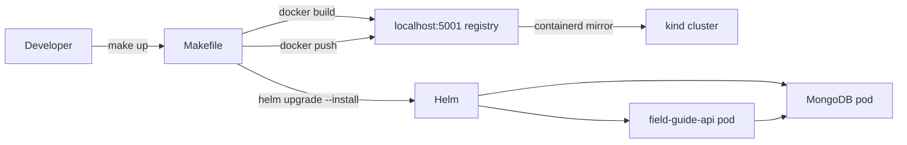

# k8s-launchpad

A self-hosted Internal Developer Platform (IDP) — a "mini-Heroku" running on a local Kubernetes
cluster. k8s-launchpad automatically builds (Docker), deploys (Helm), syncs (ArgoCD), monitors
(Prometheus/Grafana/Loki), and security-scans (Trivy) applications from a registered Git repo.
Built as a portfolio piece to demonstrate platform-engineering-level thinking.

**PRD-1 scope (this milestone):** monorepo layout, a Flask field-guide API as the platform's
dogfood app, containerisation, a local kind cluster with a local registry, and Helm deployment.
Everything runs locally and for free. One command brings it all up:

```
make cluster-up && make build && make load && make deploy
```

## Architecture



## What This Proves

- **Local Kubernetes from scratch** — kind cluster + containerd registry mirror wired in a single
  idempotent `make cluster-up` call; no cloud, no cost.
- **Complete build-to-deploy loop** — `make up` chains Docker build → registry push → Helm
  install in one target; every step is a named, overridable make target.
- **GitOps seam (PRD-2)** — `infra/argocd/` directory reserved; ArgoCD will watch this repo
  and reconcile the Helm release automatically.
- **Observability seam (PRD-4)** — app already exposes `/metrics` in Prometheus format; adding
  a scrape config is the only change needed in a future phase.
- **Generic Helm chart (PRD-3)** — `values.yaml` is structured so the platform layer can
  template new apps by supplying a different `image.*` block.
- **Self-documenting DX** — bare `make` prints a columnar help listing; `make smoke` proves the
  deployed stack is live in under 10 seconds.

## Prerequisites

| Tool | Minimum | Install |
|------|---------|---------|
| Docker Desktop | 27.x | https://docs.docker.com/desktop/install/windows-install/ |
| kind | 0.32.0 | `winget install Kubernetes.kind` |
| Helm | 3.21+ or 4.x | `winget install Helm.Helm` |
| kubectl | 1.29+ | `winget install Kubernetes.kubectl` |
| GNU make | 4.x | included with Git for Windows / WSL2 |

After installing, verify everything is on PATH:

```bash
make check-tools
```

Windows users: **Git Bash is the primary supported shell.** See [docs/windows-setup.md](docs/windows-setup.md)
for `winget` install commands, the `MSYS_NO_PATHCONV` explanation, and WSL2 as an alternative path.

## Quickstart

```bash
git clone https://github.com/Dude775/k8s-launchpad.git
cd k8s-launchpad
make check-tools   # verify Docker, kind, Helm, kubectl, bash are on PATH
make up            # cluster-up → build → load → deploy (full stack in one command)
make smoke         # curl /health, /entries, /metrics — all must return 200
```

Expected `make smoke` output:

```
==> Starting smoke test...
  PASS  /health → 200
  PASS  /entries → 200
  PASS  /metrics → 200
==> smoke PASSED
```

## Developer Loop

```bash
make test          # run pytest (32 tests, 100% coverage) inside an auto-managed venv
make build         # rebuild the Docker image after code changes
make load          # push the updated image to the local registry
make deploy        # helm upgrade --install (idempotent; waits for pods to be Ready)
make smoke         # confirm the live stack returns 200 on all three endpoints
```

Run `make help` (or bare `make`) for the full target listing with one-line descriptions.

## Demo Flow

Start a port-forward to reach the ClusterIP service on localhost:

```bash
kubectl port-forward svc/field-guide-api 8080:80
```

Then in a second terminal, hit all three endpoints:

```bash
curl http://localhost:8080/health
# {"status":"ok","mongo":"up"}

curl http://localhost:8080/entries
# []

curl http://localhost:8080/metrics
# HELP python_gc_objects_collected_total Objects collected during gc
# TYPE python_gc_objects_collected_total counter
# python_gc_objects_collected_total{generation="0"} 658.0
# ...
# HELP flask_exporter_info Information about the Flask exporter
# TYPE flask_exporter_info gauge
# flask_exporter_info{version="0.23.2"} 1.0
```

Press Ctrl-C in the port-forward terminal to stop.

**Screenshots (planned):**
- [ ] Platform dashboard showing registered repos (PRD-3)
- [ ] Grafana dashboard with request-rate + error-rate panels (PRD-4)
- [ ] ArgoCD app health view with synced Helm release (PRD-2)

## Repository Layout

| Directory | Purpose |
|-----------|---------|
| `apps/` | Application source code (e.g. `apps/field-guide-api/`) |
| `charts/` | Helm charts for each application (e.g. `charts/field-guide-api/`) |
| `infra/kind/` | kind cluster configuration and local registry setup |
| `infra/argocd/` | PRD-2 GitOps seam — ArgoCD manifests (empty this milestone) |
| `infra/observability/` | PRD-4 observability seam — Prometheus/Grafana/Loki (empty this milestone) |
| `scripts/` | Automation scripts (cluster bootstrap, image loading, etc.) |
| `docs/` | Project documentation |

## Security Note

The Helm chart ships with a committed local-dev MongoDB password (`fieldguide-dev-password`).
`helm install` prints a loud warning at deploy time:

```
!! WARNING: MongoDB is running with the COMMITTED local-dev password.
!! This is acceptable ONLY on a local kind cluster.
```

This is intentional for frictionless local setup. For anything beyond a local kind cluster,
override it at deploy time:

```bash
helm upgrade field-guide-api charts/field-guide-api --set mongodb.auth.password=<real-password>
```

See [docs/known-limitations.md](docs/known-limitations.md) for the full list of PRD-1 caveats.

## Known Limitations & Roadmap

PRD-1 deliberately excludes ArgoCD, a platform dashboard, Prometheus/Grafana/Loki, and TLS.
See [docs/known-limitations.md](docs/known-limitations.md) for the complete list with rationale
and the PRD roadmap each item maps to.

## Troubleshooting

Common failure modes (`ImagePullBackOff`, CRLF line endings, `/health` 503, stale port-forward)
with their causes and fixes are documented in [docs/troubleshooting.md](docs/troubleshooting.md).
