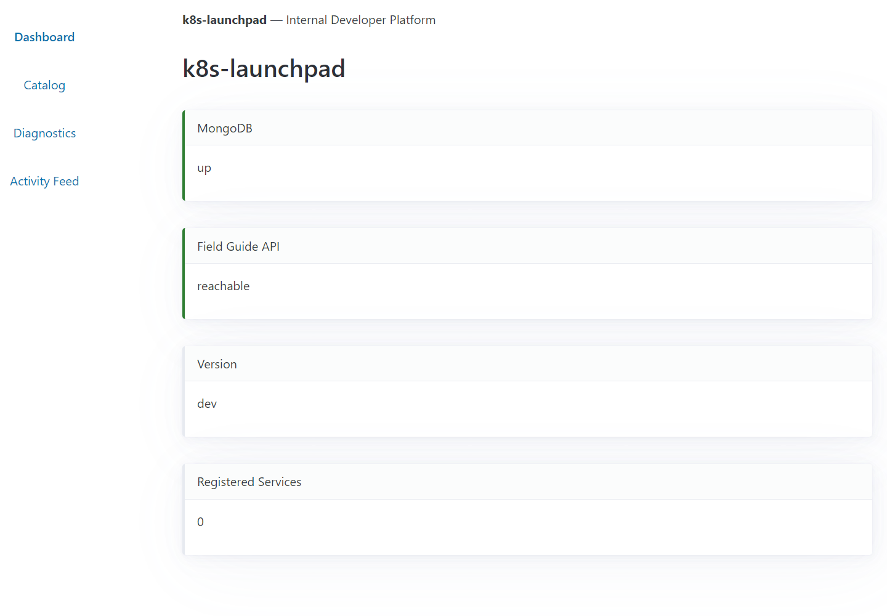
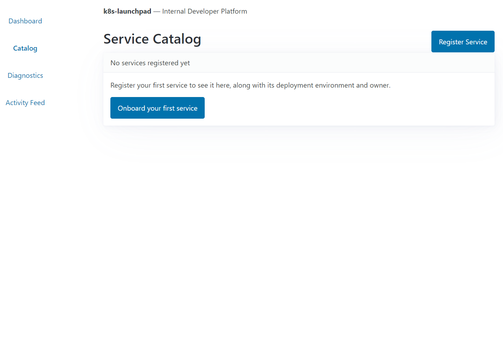
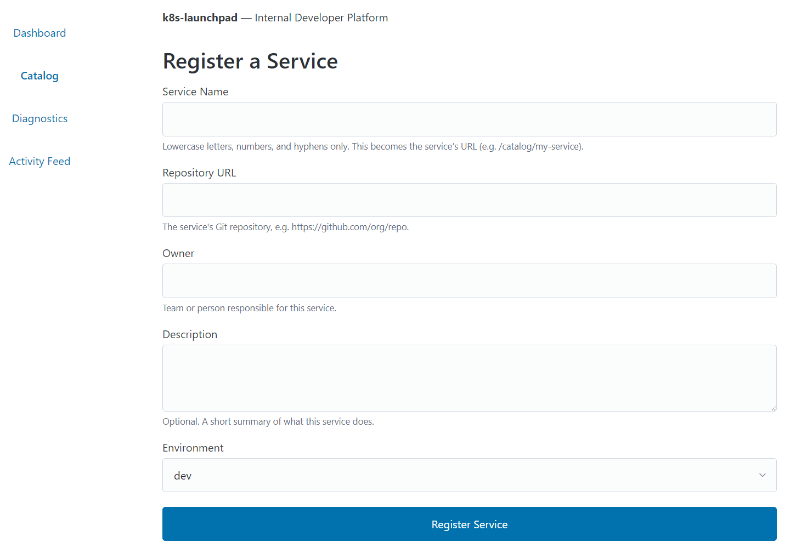
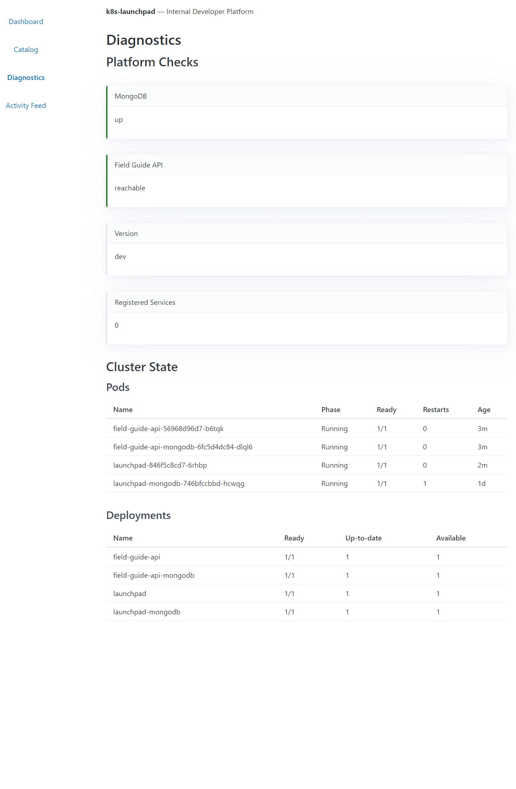
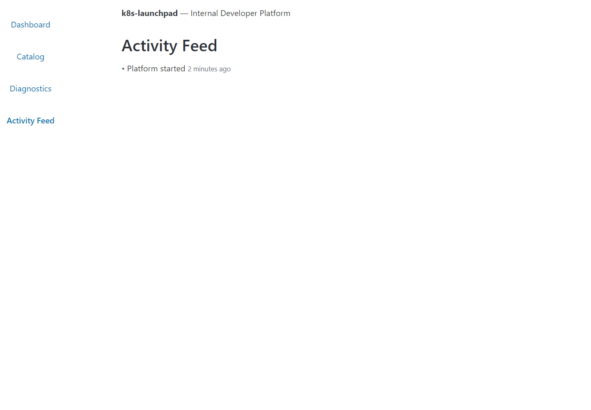
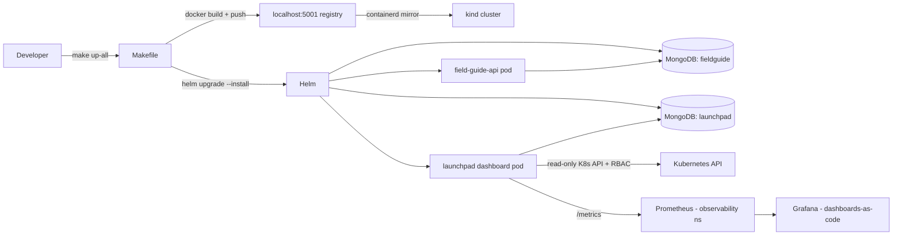

# k8s-launchpad

A self-hosted Internal Developer Platform (IDP) — a "mini-Heroku" running entirely on a local
Kubernetes cluster. A developer registers an app through a web dashboard; the platform
builds it (Docker), deploys it (Helm), and monitors it (Prometheus/Grafana) — with a
self-diagnostics engine that health-checks the platform's own components. Built as a
portfolio flagship to demonstrate platform-engineering-level thinking, with a GSD
(Goal-Driven Development) process trail: every phase ships with a plan, a summary, a
review, and a security audit.

> Real numbers, taken from the project's own planning and security artifacts (not marketing):
> 160 unit tests across two Flask workloads at 100% coverage, 27/27 milestone requirements
> audited, 4/4 end-to-end demo flows verified, and a per-phase STRIDE threat-modeling pass
> (0 open threats at every phase boundary).

---

## Why It Exists

- Prove a complete **build → push → Helm-deploy → smoke** loop against a real local cluster
  (`kind`), one command end-to-end, no cloud, zero cost.
- Demonstrate **platform engineering**, not just app deployment: generic Helm charts,
  least-privilege RBAC, observability seams, security threat models, and a readable,
  reviewer-friendly commit history.
- Be the demo a human can open in a browser in under two minutes: `make up-all`, then
  `http://localhost:8081` shows live status cards, a service catalog, K8s diagnostics, and an
  activity feed.

---

## Live Demo


*Launchpad dashboard — status cards for MongoDB, Field Guide API, version, and registered services.*


*Launchpad service catalog — empty state with the "Onboard your first service" CTA.*


*Launchpad onboard form — "Register a Service".*


*Launchpad diagnostics — platform checks and cluster state showing pods and deployments.*


*Launchpad activity feed — "Platform started" event.*

---

## Sold-By-Numbers (verified in-repo)

| Metric | Value | Source in repo |
|---|---|---|
| Unit tests — `field-guide-api` | **32 tests, 100% coverage** | `make test`, Phase 1 verification |
| Unit tests — `launchpad` | **128 tests, 100% coverage** | `make test-launchpad`, Phase 9 verification |
| Milestone audit (v1.1) | **27/27 requirements, 4/4 E2E flows** | `.planning/milestones/v1.1-MILESTONE-AUDIT.md` |
| STRIDE threat modeling | **per-phase; 0 open threats every phase** | `*-SECURITY.md` (Phase 1: 11/11, Phase 3: 12/12, Phase 10: 7/7, Phase 11: 10/10) |
| v1.0 velocity | 4 phases, 12 plans, **114 commits**, 4 days | `.planning/STATE.md` |
| v1.1 velocity | 6 phases, 14 plans, 36 tasks, **142 commits**, 7 days | `.planning/STATE.md` |
| v2.0 Phase 11 | 14/14 must-haves verified (OBS-01/02) | `.planning/PROJECT.md` Current State |
| Screenshots of live demo | 5 real captures (dashboard, catalog, onboard, diagnostics, feed) | `docs/screenshots/` |
| Runtime footprint (both apps + 2 MongoDBs) | fits a Docker-Desktop kind node; observability stack trimmed to ~516 MiB requests | `infra/observability/values-trimmed.yaml`, Phase 11 |

---

## Stack (locked, pinned versions)

### Applications

| Layer | Technology | Version |
|---|---|---|
| Runtime | Python | 3.11 (`python:3.11-slim`, multi-stage build, non-root **UID 10001**) |
| API (workload) | Flask + Flask-PyMongo | 3.1.3 / 3.0.1 |
| API (platform) | Flask app factory + gunicorn (PID 1, exec-form) | 3.1.3 / 26.0.0 |
| DB | MongoDB in-cluster (plain `mongo:7` manifests, NOT Bitnami) | 7 |
| K8s client (diagnostics) | official `kubernetes` client | 33.1.0 (aligned with K8s 1.33) |
| Web forms / CSRF | Flask-WTF | 1.3.0 |
| Metrics | prometheus-flask-exporter (`/metrics` on both apps) | 0.23.2 |
| UI | Jinja2 + vendored **htmx** (no build step, no CDN, fully offline) | 2.0.10 |
| UI CSS | vendored **Pico.css** (+ Mission Control dark layer) | 2.1.1 |
| Tests | pytest + pytest-cov (`--cov-fail-under=95`) | 9.1.1 |

### Cluster & Tooling

| Tool | Version / Detail |
|---|---|
| kind (local cluster) | 0.32.0 — node image Kubernetes **1.33.1** |
| Local registry | `registry:3` on `localhost:5001`, loopback-only (`127.0.0.1`), per-node `containerd` `hosts.toml` mirror |
| Helm | 3.x — two independent charts, `apiVersion: v2` |
| Make | AWK-powered self-documenting help; `MSYS_NO_PATHCONV=1`, `.NOTPARALLEL`, Git-Bash supported |
| Git hygiene | `.gitattributes` `* text=auto eol=lf` + per-type rules (CRLF/LF threat policy) |

### v2.0 Observability Additions (Phase 11 shipped)

| Component | Detail |
|---|---|
| kube-prometheus-stack (Helm chart, pinned) | **87.16.1** — operator + Prometheus + Grafana 12.7.2 + kube-state-metrics 7.8.1 |
| Trimmed (deliberately disabled) | Alertmanager, node-exporter, defaultRules (resource budget on kind) |
| Deploy | `make observability-up` into its own `observability` namespace; **port-forward only**, no Ingress/NodePort |
| Dashboards | Grafana dashboards-as-code via sidecar ConfigMaps (`grafana_dashboard: "1"`) |
| Governance | pinned chart version, live resource caps on all kept components, teardown scoped to release + namespace |

---

## Helm Architecture

Two independent, generically-structured charts — this is the PRD-3 templating seam: a new app
is deployed by supplying a different `image.*` block.

```
charts/
├── field-guide-api/            # PRD-1 dogfood workload (Flask REST API)
│   ├── Chart.yaml              # apiVersion v2, app 0.1.0
│   ├── values.yaml             # image / service / resources / config / mongodb blocks
│   └── templates/
│       ├── deployment.yaml     # non-root, runAsNonRoot, allowPrivilegeEscalation: false
│       ├── service.yaml        # ClusterIP :80 → :8000
│       ├── configmap.yaml      # app config (no secrets)
│       ├── secret.yaml         # MONGO_URI via stringData + secretKeyRef only
│       ├── mongodb/            # embedded mongo:7: deployment, service, PVC (1Gi), secret
│       └── NOTES.txt           # loud local-dev-password warning
└── launchpad/                  # PRD-3 platform dashboard (the product)
    ├── Chart.yaml
    ├── values.yaml             # same schema + metrics.enabled, eventsTtlSeconds (604800 = 7-day TTL)
    └── templates/
        ├── (same set as field-guide-api …)
        └── rbac.yaml           # ServiceAccount + namespace-scoped Role + RoleBinding
                                #   rules: pods + deployments, verbs: get/list/watch
                                #   (read-only, least privilege, NEVER ClusterRole, T-08-01)
```

Key design decisions (all documented in `.planning/PROJECT.md` Key Decisions):

1. **Embedded MongoDB per chart** (plain `mongo:7`, not Bitnami — paywalled since Sep 2025).
   Each app is independently installable/uninstallable; a Deployment-bound PVC (not a
   StatefulSet) makes `helm uninstall` remove storage cleanly. TTL index (7 days) on the
   events collection, verified live by `make verify-ttl TTL_DEEP=1`.
2. **Readiness isolation**: `/health` checks only the pod's own MongoDB; downstream reachability
   (field-guide, Prometheus) lives in the aggregated `/api/status` — the readiness probe never
   couples to optional services.
3. **RBAC diagnostics**: the dashboard queries the K8s API in-cluster through a dedicated
   ServiceAccount bound to a namespace-scoped Role (pods + deployments, read-only), with all
   three failure branches (outside-cluster / 403 / timeout) tested — never a 500.
4. **Identity + secrets**: `SECRET_KEY`, MongoDB passwords and the `MONGO_URI` are
   local-dev-only chart values with a clear "override with `--set` for anything real"
   convention, loudly surfaced in `helm install` output.
5. **No-internet UI**: htmx + Pico vendored into the repo — the dashboard renders fully
   offline, no CDN, no build step.

---

## Security (STRIDE threat modeling)

Every phase carries a per-phase threat register in `*-SECURITY.md` (STRIDE categories), each
threat with a disposition (`mitigate` / `accept`), evidence, and an audit line.
**Zero open threats at every phase boundary.**

| Artifact | Threat total | Closed | Open |
|---|---|---|---|
| Phase 1 — Scaffold + App + Tests | 11 | 11 | 0 |
| Phase 2 — Cluster Infrastructure | 6 | 6 | 0 |
| Phase 3 — Containerization + Helm | 12 | 12 | 0 |
| Phase 10 — Makefile + Smoke + Docs | 7 | 7 | 0 |
| Phase 11 — Observability Stack | 10 | 10 | 0 |

Representative mitigations (verbatim from the registers):

- **Elevation of privilege**: non-root `UID 10001` + `runAsNonRoot: true` + `allowPrivilegeEscalation: false` (T-03-01, T-03-07); registry bound to `127.0.0.1:5001` only (T-02-01); Grafana/Prometheus reachable via port-forward only (T-11-03).
- **Tampering / supply chain**: exact-pin `==` on all runtime and test deps (T-02-SC, T-03-01-SC); explicit `COPY app/ ./app/` with no broad `COPY . .` (T-03-02); chart version pinned `87.16.1` with provenance round-trip (T-11-SC).
- **Information disclosure**: `MONGO_URI`/passwords only via `stringData` + `secretKeyRef`, never in ConfigMaps or NOTES (T-03-04, T-03-05); `.gitignore` + staged-commit hygiene before the first commit (T-01-01, T-01-03); `FLASK_DEBUG` default-empty/disabled (T-03-03).
- **Spoofing / false-green**: `mongo_down` fixture exercises the 503 branch; `--cov-fail-under=95` fails the suite on coverage drop (T-03-03, Phase 1).
- **DoS**: resource `requests/limits` on every observability component + preflight capacity gate + post-install smoke re-check (T-11-02).

Accepted risks (documented, not hidden): unbounded `GET /entries` scan (single-user local,
re-evaluate at multi-user), loopback HTTP registry traffic, committed **local-dev-only**
passwords (`fieldguide-dev-password`, `launchpad-dev-password`, `grafana-dev-password`) —
each with an override command and a dedicated section in `docs/known-limitations.md`.

---

## Architecture (as-built)



Two Flask workloads, two charts, two in-cluster MongoDBs, one kind cluster, one local
registry, and (v2.0) one trimmed Prometheus/Grafana stack in its own namespace — all
brought up by one command and torn down cleanly.

---

## Quickstart (runs entirely locally, free)

```bash
git clone https://github.com/Dude775/k8s-launchpad.git
cd k8s-launchpad
make check-tools          # verify Docker, kind, helm, kubectl, bash on PATH
make up-all               # cluster-up → build → load → deploy BOTH apps (one command)
make port-forward-launchpad   # second terminal: svc/launchpad → localhost:8081
# open http://localhost:8081 — live dashboard
make smoke-all            # curl-verify both apps (8080 field-guide-api / 8081 launchpad)
```

Key targets: `make cluster-up`, `build`, `load`, `deploy`, `smoke`, `test`,
`up-all`, `smoke-all`, `test-launchpad`, `verify-ttl`, `clean`, `reset-local`, plus v2.0
`observability-up` / `observability-down` / `port-forward-grafana` and the umbrella
`up-mission-control` (Phase 17). Bare `make` prints the full, self-documenting help.

Smoke expectations (`make smoke-all`):

```
PASS  /health → 200       PASS  / → 200
PASS  /entries → 200      PASS  /health → 200
PASS  /metrics → 200      PASS  /api/status → 200
```

---

## Repository Layout

| Path | Purpose |
|---|---|
| `apps/field-guide-api/` | PRD-1 dogfood workload: Flask REST API (src, tests, Dockerfile, requirements) |
| `apps/launchpad/` | Platform product: dashboard app (app factory, routes, templates, vendored assets, 128 tests) |
| `charts/field-guide-api/` | Generic Helm chart + embedded mongo:7 |
| `charts/launchpad/` | Same schema + RBAC templates + own mongo:7 |
| `infra/kind/` | kind cluster config + local registry wiring |
| `infra/observability/` | Trimmed kube-prometheus-stack values + ServiceMonitors + dashboard ConfigMaps (v2.0) |
| `infra/argocd/` | Reserved GitOps seam (PRD-2, deferred) |
| `scripts/` | `cluster-setup.sh`, `cluster-teardown.sh`, `observability-up.sh`, `observability-down.sh` |
| `docs/` | Screenshots, troubleshooting, windows-setup, known-limitations |
| `.planning/` | Full GSD trail: PROJECT.md, STATE.md, ROADMAP.md, per-phase PLAN/SUMMARY/REVIEW/SECURITY |

---

## Milestones

| Milestone | Scope | Status |
|---|---|---|
| **v1.0 Foundation** (Phases 1-4) | App + tests, kind cluster + registry, containerization, Helm deploy, Makefile DX | ✅ shipped 2026-07-07 |
| **v1.1 Product Dashboard** (Phases 5-10) | launchpad app factory, UI (htmx/Pico), status API, service catalog + events (CRUD, CSRF, 7-day TTL), K8s diagnostics with RBAC, own Helm chart, `make up-all` | ✅ shipped 2026-07-14 |
| **v2.0 Observability + Mission Control** (Phases 11-17) | Trimmed kube-prometheus-stack (Phase 11 ✅ 14/14), ServiceMonitor scraping (12), Grafana dashboards-as-code (13), additive Makefile targets (14), native metric cards w/ graceful degradation (15), Mission Control dark reskin (16), demo seeding + one-command flagship demo (17) | 🔶 in progress — Phase 12 next |
| Deferred | PRD-2 ArgoCD GitOps, Loki/logs + Alertmanager (v2.1), Trivy, AWS/EKS/Terraform | — |

---

## Tradeoffs & What I'd Do Differently (interview section)

- **Local-only by design, borrowed platform**: kind + local registry prove the loop but not
  managed-cloud reality; the AWS/EKS path is deliberately deferred to the final PRD.
- **Committed local-dev passwords** are an accepted tradeoff for one-command DX; they are loud,
  documented, and override-safe — the convention mirrors what many real platforms ship.
- **Dashboard without a deploy pipeline**: v1.1 registers services but doesn't (yet) wire
  registration → real build/deploy (PLAT-01, deferred); the Helm values seam is the hook for it.
- **Two embedded MongoDBs instead of one shared instance**: favors independent chart lifecycle
  over resource economy — the right call for the architecture demo, wasteful at scale.
- **No auth / single user**: scoped correctly for a portfolio demo; multi-user would force
  real auth decisions (T-02-04 was re-evaluated at PRD-3 and stayed accepted).

---

*Sources for every number above: the repo's own `.planning/` artifacts (PROJECT.md,
STATE.md, STACK.md, *-SECURITY.md, v1.1-MILESTONE-AUDIT.md), `charts/*`, `Makefile`, and
`infra/*` — verified 2026-08-31.*
